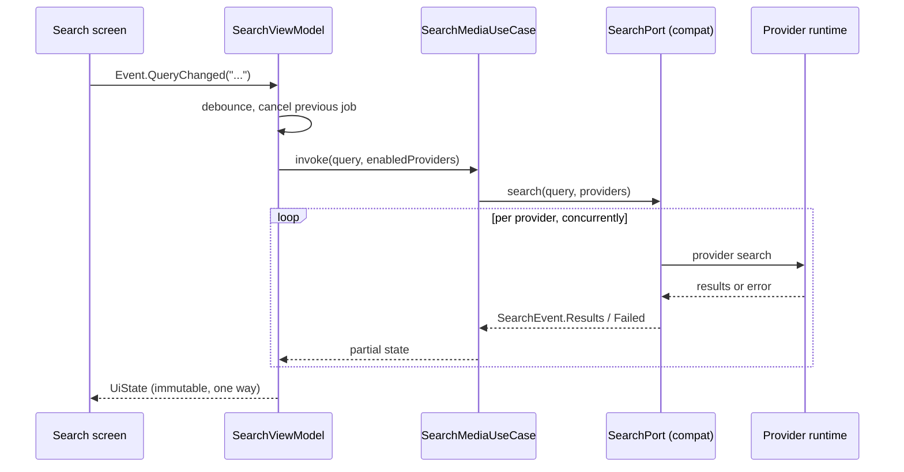
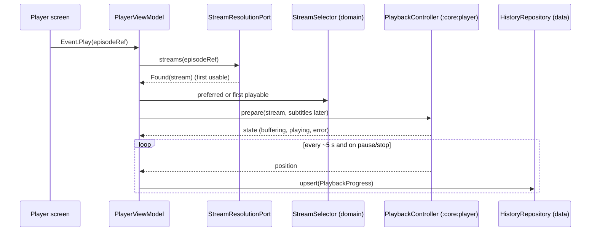
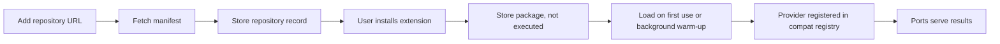

# HUSH — Data flow

Status: PROPOSED. Describes intended flows. Nothing here is implemented yet.
Ports referenced are provisional (see INTEGRATION_CONTRACTS.md).

## 1. Search

- Partial results render as they arrive. A failed provider appears as a per-provider message, not a whole-screen error.
- Cancelling the query cancels every in-flight provider call.

## 2. Media details and episodes
- Details load once per screen entry and are cached in memory for the screen's lifetime only.
- Episodes load for the selected season. The season switch is a new call, not a client-side filter, unless details already contained the episodes.

## 3. Stream resolution and playback

- Playback starts on the first playable stream. Later stream events are kept as fallbacks.
- On a playback error, the ViewModel tries the next fallback stream before showing an error.
- Subtitles load in parallel with playback start. Missing subtitles never block playback.

## 4. Subtitles
- Requested after the episode is chosen, through SubtitlePort. Results are mapped to Media3 subtitle configurations inside `:core:player`.
- Subtitle selection is stored per show in DataStore (planned) so the choice survives sessions.

## 5. Persistence writes
- Watch progress: throttled, as above. A final write happens on stop and when the app leaves the foreground.
- Favourites and bookmarks: immediate write, observed back as a `Flow` from Room, so the UI updates from the database and not from optimistic local state.

## 6. Extension lifecycle

- Steps A to E never run extension code. This is a hard rule until Agent 1's security analysis is accepted.
- The registry is owned by compat. The app observes it through `ProviderCatalogPort`.

## 7. Cold start
1. `Application.onCreate` builds `AppContainer` with cheap objects only (no database open, no extension load).
2. `MainActivity` renders the first frame from a default state.
3. Repository and provider warm-up is started on a background dispatcher after first frame.
4. Room opens on first access.

## 8. Failure paths
- Network failure: retryable `AppError.Network`, surfaced per screen with a retry action.
- Extension failure: isolated to that provider. Other providers continue.
- Playback failure: fallback stream, then a recoverable error state with retry.
- Persistence failure: logged, surfaced as a non-blocking message. Never silently dropped for watch progress without notice.
