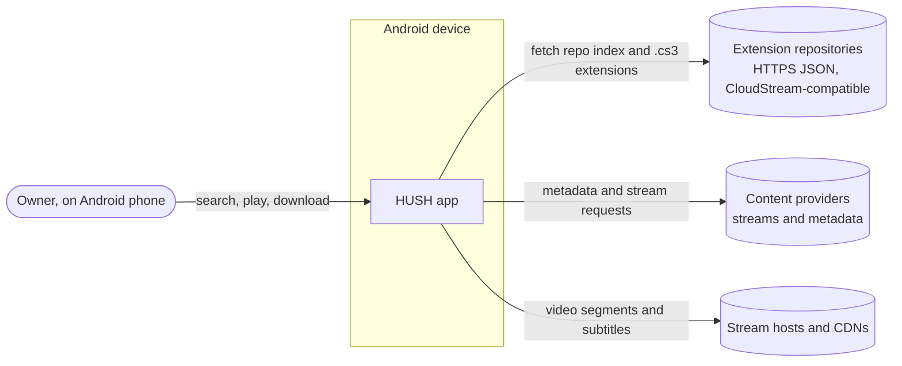
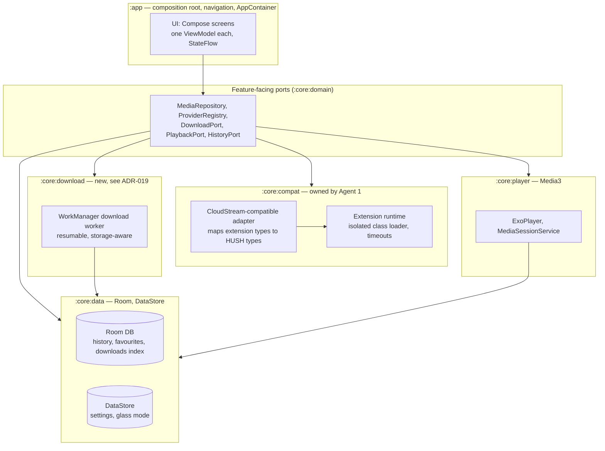

# HUSH — Software Architecture (drivers, diagrams, decisions)

Status: PROPOSED, for owner sign-off. Build: UNVERIFIED (see docs/PROJECT_STATUS.md).
Companion to `ARCHITECTURE.md` (module layout, written by Agent 2). This document records the
drivers and the forks that were decided on 2026-11-25, and their rationale. It does not repeat the
module table.

No SRS exists (`docs/srs.md` missing). Drivers below are stated in prose, not by requirement ID.

## 1. Drivers

Confirmed by owner (2026-11-25):
- Distribution: sideloaded APK only (GitHub Releases). No Play Store for now.
- No accounts, no cross-device sync, no backend server. All user data stays on the phone.
- Offline download is in scope now (not deferred).
- Testing: manual device testing only. No automated test gate is required by the owner.

Inferred (assumed, owner to correct if wrong):
- Android only. No iOS, so no Kotlin Multiplatform.
- One developer plus AI agents. Kotlin and Compose are the team's stack.
- Personal and small-audience use. Scale is not a driver. Peak load is one device.
- Latency: UI should feel instant. Stream start time depends on the provider, not on HUSH.

Quality attributes that now drive the design, in order:
1. **Privacy and local control.** Nothing leaves the phone except provider and stream requests the user triggers.
2. **Isolation of untrusted extension code.** A broken or hostile provider must not crash or
   compromise the app or the user's data.
3. **Responsiveness.** Main thread never waits on the network, disk or extension code.
4. **Offline resilience.** Downloads and history survive app kill, reboot and network loss.
5. **Maintainability for a small team.** Few modules, no DI framework, simple state flow.

Hard constraints:
- CloudStream is GPL-3.0. HUSH is GPL-3.0 (D-007). Any copied code needs attribution.
- Existing CloudStream repositories and extensions must keep working (handover §0/§6).
- Namespace `app.hushstream` is provisional (D-002). Do not ship under it.

## 2. System context (C4 level 1)

There is no HUSH server. Every outbound call is initiated by the user action in the app.

## 3. Containers (C4 level 2)

Rules carried over from ARCHITECTURE.md: UI never imports `:core:compat`. Only `:core:compat` may
reference CloudStream APIs. `:app` wires everything.

## 4. Key runtime flows

**Play a stream (vertical slice):** user taps Play → details ViewModel asks domain for streams →
compat adapter calls the provider in the isolated runtime with a timeout → streams return as
domain `StreamSource` values → player takes the chosen URL. Failure of one provider never fails
the others (ADR-018 rule).

**Download an episode (new):** user taps Download → `DownloadPort.enqueue` writes a row to the
Room downloads index → WorkManager worker resolves the stream URL again at run time (URLs expire)
→ writes to app-private storage in chunks, records progress → on app kill the worker resumes from
the last chunk → playback of a finished download reads the local file and never calls a provider.

## 5. Decisions

### ADR-018 — Provider failure isolation
- **Status:** Accepted (owner did not object; carried from ARCHITECTURE.md §8).
- **Context:** Extensions are third-party code. They can be slow, broken or malicious.
- **Options:** (a) run everything in-process with no limits; (b) per-call timeouts and error
  mapping in-process; (c) separate process per provider.
- **Decision:** (b) now. Per-call timeout, exception mapping to `AppError`, cancellation on screen exit.
- **Consequences:** A hostile extension can still read app memory in-process. A separate process
  (c) is the upgrade path if the owner adds untrusted repositories. Revisit before any public release.
- **Requirements addressed:** isolation (driver 2), responsiveness (driver 3).

### ADR-019 — Offline downloads: WorkManager with a Room index, app-private storage
- **Status:** PROPOSED. Needs owner sign-off, and it adds scope to the vertical slice.
- **Context:** Owner wants offline playback now. Stream URLs from providers expire, and downloads
  must survive app kill and reboot.
- **Options:**
  1. Foreground service with a hand-written downloader. Full control, but it is more code to get
     right (retries, resume, battery rules).
  2. WorkManager with a resumable HTTP worker, index in Room. Survives reboot, respects battery and
     network constraints, less custom lifecycle code.
  3. Use Media3 `DownloadManager`. Built for HLS and DASH and fits ExoPlayer, but it is harder to
     plug into extension-resolved URLs and sources that are not HLS.
- **Decision:** Option 2 for plain HTTP files. Revisit option 3 only if streams are mostly HLS
  or DASH.
- **Storage:** app-private external files directory. No shared storage, no permission prompt.
  A storage-full check runs before enqueue.
- **Consequences:** Downloads are tied to the app's data. Uninstalling removes them, which is
  acceptable for a sideloaded personal app. Re-resolving the stream URL in the worker keeps
  expired links from failing the job.
- **Open risk (owner to decide):** offline copies of third-party streams may breach the source
  provider's terms or local law. This is a legal question, not an engineering one. Record the
  owner's answer in DECISION_LOG before shipping the download feature.
- **Requirements addressed:** offline resilience (driver 4), privacy (driver 1; files stay on device).

### ADR-020 — Distribution: sideload APK, no Play Store yet
- **Status:** Accepted by owner.
- **Context:** Owner chose GitHub Releases. Store listing needs a cleared name and store policy
  review, and HUSH is not legally cleared (D-001).
- **Decision:** Build a signed release APK in CI for GitHub Releases. Keep the debug APK artifact
  in CI for device testing. Keep `app.hushstream` until the naming audit (D-002) ends.
- **Consequences:** Users install with "unknown sources" enabled. Auto-updates are manual.
  Signing key must be stored as a GitHub secret, never in the repo.
- **Requirements addressed:** distribution (driver: owner decision), privacy (no store tracking SDKs).

### ADR-021 — No backend, no accounts
- **Status:** Accepted by owner.
- **Context:** No sync was requested. A server adds auth, hosting, data-protection duties and an
  attack surface.
- **Decision:** All state is on device: Room for history, favourites and downloads, DataStore for
  settings. Repository files are fetched directly from their URLs.
- **Consequences:** Backup and restore need a later, explicit export feature. Reinstalling loses
  history. Revisit if the owner wants cross-device sync.
- **Requirements addressed:** privacy and local control (driver 1).

### ADR-022 — Testing: manual device testing as the gate
- **Status:** Accepted by owner, with a note.
- **Context:** Owner chose manual device testing only.
- **Decision:** Device testing is the acceptance gate. CI still builds the APK on every push, so a
  broken compile is caught without tests.
- **Note:** CLAUDE.md rule 3 still applies. Every "works" claim needs a device or build result,
  named in the report.
- **Consequences:** Regressions in domain logic will not be caught automatically. The owner
  accepts that trade-off. Reconsider if the codebase grows past the vertical slice.

## 6. Risks

| Risk | Impact | Mitigation |
|---|---|---|
| Offline download legality (ADR-019) | Legal exposure | Owner decides before the download feature ships |
| Extension code runs in-process (ADR-018) | Security | Timeouts and error mapping now; process isolation before public release |
| Manual testing only (ADR-022) | Regressions | Keep the vertical slice small; CI build on every push |
| Scope grew (offline download added) | Slower first device test | Ship the streaming slice first, then the download milestone |
| Placeholder namespace (D-002) | Rename cost later | Rename before the first public release, not before device testing |

## 7. Not decided here
- Compat API names for CloudStream extensions: still blocked on the M3 legal review.
- Final namespace and copyright holder: owner decision (D-002).
- Minimum SDK: provisional 26, Agent 1 to confirm against the extension runtime.
